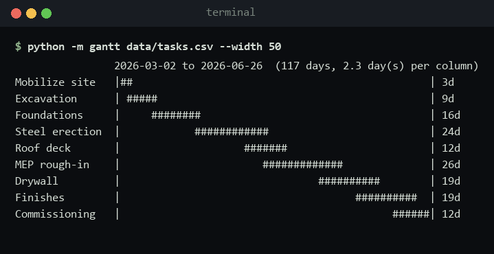

# construction-schedule-gantt

Turn a CSV of construction tasks into a text Gantt chart and an optional SVG file.



## What it is for

A project engineer or planner often keeps the schedule in a spreadsheet, but a spreadsheet does not show overlap between tasks at a glance. A Gantt chart is a bar chart where each task is a bar placed along a calendar, so you can see what runs in parallel. This tool reads task names with start and end dates and draws the chart in the terminal or as an SVG picture you can drop into a report. It needs no scheduling software.

## Install

```
git clone <this repo> && cd construction-schedule-gantt
python -m pip install -r requirements.txt
set PYTHONPATH=src   (Windows)  or  export PYTHONPATH=src
```

Python 3.10 or newer. The tool uses only the standard library; `requirements.txt` lists pytest for the tests.

## How to use

| I want to | Command |
|---|---|
| Print a text chart | `python -m gantt data/tasks.csv` |
| Change the chart width in columns | `python -m gantt data/tasks.csv --width 80` |
| Also save an SVG picture | `python -m gantt data/tasks.csv --svg chart.svg` |

Worked example:

```
$ python -m gantt data/tasks.csv --width 50
                2026-03-02 to 2026-06-26  (117 days, 2.3 day(s) per column)
Mobilize site   |##                                                | 3d
Excavation      | #####                                            | 9d
Foundations     |     ########                                     | 16d
Steel erection  |            ############                          | 24d
Roof deck       |                    #######                       | 12d
MEP rough-in    |                       #############              | 26d
Drywall         |                                ##########        | 19d
Finishes        |                                      ##########  | 19d
Commissioning   |                                            ######| 12d
```

## How it works

- `core.load` reads name, start and end columns. Dates are ISO (YYYY-MM-DD) and the end date is inclusive.
- Tasks are sorted by start date.
- The text chart divides the whole span into at most `--width` columns, so one column may cover more than one day. Every task gets at least one `#`.
- The SVG chart draws one rectangle per task, 12 pixels per day, with a tick label on each Monday. Task names are escaped.
- It does not model dependencies; use the critical-path-calculator repo for that.

## Limits

Start and end dates are given directly; it does not calculate dates from durations or dependencies. The text chart rounds to whole columns when the span is longer than the width. Colors and styles of the SVG are fixed. The sample file is invented.

## License

MIT. Yassine Emhamed, 2026.
